<!-- ═══════════════════════════ SOBRE ═══════════════════════════ -->
## Sobre mim

<table>
  <tr>
    <td width="54%" valign="middle">

Sou estudante de **Ciência da Computação** e desenvolvedor **Full Stack**. Gosto de transformar ideias em aplicações úteis, unindo interfaces bem construídas, lógica de negócio e aprendizado constante.

```yaml
nome:       Gabriel Costa
curso:      Ciência da Computação (P2)
foco:       Desenvolvimento Full Stack
explorando: [Web, Automação, IA Local]
local:      João Pessoa, PB — Brasil
disponivel: Projetos colaborativos e novos desafios 🚀
```

</td>
    <td width="46%" align="center">
      
    </td>
  </tr>
</table>

<div align="center">
<a href="https://github.com/gabriellcs7">
  
</a>

<br/>


<a href="https://github.com/gabriellcs7?tab=followers"></a>


</div>
</div>


<!-- ═══════════════════════════ STACK ═══════════════════════════ -->
## Stack & ferramentas

<div align="center">

**Linguagens & Web**


**Ambiente de desenvolvimento**


</div>


<!-- ═══════════════════════════ PROJETOS ═══════════════════════════ -->
## Projetos em destaque

<div align="center">
  <a href="https://github.com/gabriellcs7/BackLog">
    
  </a>
  <a href="https://github.com/gabriellcs7/IA-Local">
    
  </a>
  <a href="https://github.com/gabriellcs7/BoletimFaculdade">
    
  </a>
  <a href="https://github.com/gabriellcs7/ironlung-academia">
    
  </a>
</div>

<br/>

<div align="center">


<a href="https://github.com/gabriellcs7?tab=repositories">
  
</a>

</div>

<!-- ═══════════════════════════ CONTATO ═══════════════════════════ -->
## Vamos nos conectar?

<div align="center">

<a href="https://www.linkedin.com/in/gabriel-costa-81b482201/"></a>
<a href="mailto:gabrielcga2008@gmail.com"></a>
<a href="https://www.instagram.com/_gabriell.cs/"></a>
<a href="https://open.spotify.com/user/21vngni7dvs42ela7gljftd5a"></a>

<br/>


**Se algum projeto chamou sua atenção, deixe uma ⭐ ou venha trocar uma ideia!**

</div>
